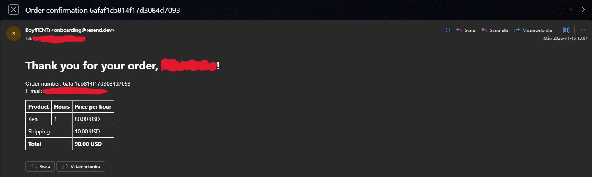

# Inlämningsuppgift 1:

## KOM IGÅNG:
https://boyf-ren-ts.vercel.app/

Obs: backend ligger på Renders gratisplan och somnar efter en stund utan trafik, så första inloggningen eller beställningen kan ta ungefär en halv minut.

### Steg för att starta klienten och servern lokalt:
1. Öppna en terminal och skriv in "cd .\frontend\" och tryck Enter, efter det skriv in "npm run dev" och tryck Enter
3. Öppna en till terminal och skriv in "cd .\backend\" och tryck Enter, efter det skriv in "npm run dev" och tryck Enter

### Testkonton:

- Kund: user1
- Lösenord: 123

- Admin kontot för läraren står i inlämningskommentaren.

### Nycklar, importtest, söktest
- Kopiera .env.example till .env och fyll i värdena. SUPPLIER_API_KEY är demonyckeln från leverantörens dokumentation. Skapa ett gratis konto på Algolia och hämta App ID, admin-nyckel och search-only-nyckel från dashboarden och sätt in dom i rätt variabel i .env filen (mall i .env.example), INDEX_NAME kan fyllas med valfritt namn. Logga in som admin och gå in på Products och klicka på reindex knappen för att manuellt uppdatera indexet (den knappen använder en POST till /api/admin/algolia/reindex)

- För att testa importen, logga in som admin, uppe i URL:en lägger man till /admin för att komma till admin sidorna, klicka på products och där finns knapparna för att testa.

- Först och främst måste man köra en Reindex. Skriv sedan något i sökrutan högst upp på produktsidan. Sökningen tillåter stavfel t.ex. skriver man Anan hittar den Anna. Söker man på Anna får man också upp Hanna (som skiljer sig med en bokstav) och Lex (som har ordet "wanna" i description)

- Skapa ett gratis Stripe konto i testläge och lägg STRIPE_SECRET_KEY, STRIPE_WEBHOOK_SECRET (whsec_-värdet som stripe listen skriver ut) samt CLIENT_URL (http://localhost:5173) i backend .env filen. Man behöver Stripe CLI installerat, och stripe login körs första gången

- Använd kortet 4242 4242 4242 4242 (med valfritt framtida utgångsdatum och valfri tre siffrig kod), se till att ha stripe listen --events checkout.session.completed,checkout.session.async_payment_succeeded,checkout.session.expired --forward-to localhost:5000/api/stripe/webhook igång lokalt med whsec_-värdet i .env filen och gå igenom beställningsflödet (add to cart, checkout, fyll i uppgifter, pay, skriv in kort uppgifterna i Stripe)

- För att testa bilduppladdningen, skapa ett gratis Supabase-projekt med en publik bucket, och lägger SUPABASE_URL (https://<id>.supabase.co), SUPABASE_SECRET_KEY och SUPABASE_BUCKET i .env filen, logga in som admin, skapa eller öppna en produkt med Edit knappen, välj en bild och ladda upp den.

- Skapa ett konto i PostNords utvecklarportal (Customer Plan), skapa en sandlådenyckel och lägg `POSTNORD_API_KEY`,`SHOP_ADDRESS` och `SHOP_POSTAL_CODE` i .env filen (sandlådans testvärden är Testvägen 3 och 17173)

## Mina val för Labb 1:
Jag valde att skippa ean och uppdaterad från leverantören då dom inte var särskilt relevanta för just min webshop. Variants sparas som en lista och age har fått gränser från 18 till 65, 18–65 är en regel för min shop, och leverantörens åldrar ligger mellan 19 och 64 så att ingen produkt faller bort. Jag valde också att lämna mina gamla "produkter" helt orörda istället för att ändra deras kategorier för att matcha dom från leverantören för att inte behöva ändra saker och ting och riskera att andra saker i koden börjar strula eller sluta fungera som dom ska. Priset och kategorin tas rakt av, och produkter som inte klarar valideringen hoppas över med en orsak i rapporten.

## Mina val för Labb 2:
Jag valde att ge mina produkter som jag hade i databasen ett artikelnummer (sku) BF-001 och uppåt och nya produkter får nästa lediga nummer automatiskt (i detta fallet BF-013 och nästa efter det får BF-014 osv.). Produktens MongoDB id som productId så att sökträffarna kan länka till produktsidan och läggas till i varukorgen. Jag valde att göra sök funktionen på ett sånt sätt att sökningen används bara när något är skrivet i sökfältet, är fältet tomt visas den vanliga produktlistan från databasen, på grund av det så funkar produktsidan oavsett om Algolia är nere, om Algolia inte svarar visar sökningen ett begripligt felmeddelande. Sidorna räknas från 1 istället för Algolias 0 genom att adaptern översätter, jag satte en standard storlek på 12 per sida och taket är 50. Jag valde att spara databasen först så att även om Algolia inte svarar så sparas ändå produkten samt att admin får en varning om att det inte sparats i indexet, för att få ikapp indexet kan man köra en reindex. Jag har också gjort så att sku inte kan ändras när man klickat på Edit på en produkt så att man inte skapar dubbletter när man sparar produkten igen. Sist men inte minst gjorde jag så att indexet uppdateras automatiskt när en ny produkt skapas, ändras, tas bort eller importeras

## Mina val för Labb 3:
Jag valde att använda Stripes hosted checkout då det lät smidigare, jag valde att priserna debiterades i USD (cents) istället för kronor då min sida var byggd med USD i åtanke från början. Jag satte in stock på mina produkter och valde att "stock" var antalet timmar som "produkten hade skrivit på kontrakt med företaget" (startsaldot låg på 10 på alla). Jag implementerade att orderstatusen gick från pending när ordern skapas, paid när webhooken bekräftat att betalningen har gått igenom en gång och cancelled när sessionen har löpt ut efter 30 minuter utan betalning. Priset räknas på servern från databasen, React skickar bara produkt och antal, webhooken verifierar signaturen så att även om samma händelse kommer flera gånger så blir ordern bara betald en gång och saldot minskar en gång.

## Mina val för Labb 4:
Jag valde att begränsa filerna till JPEG och PNG samt max 4MB både i servern och i bucketen. Varje bild får en ny unik sökväg med sku, slumpmässigt id och en ändelse, inte filnamnet från admin och en befintlig fil skrivs aldrig över. Både sökvägen imagePath och adressen imageUrl sparas på produkten, jag återanvände imageUrl så att shoppen visar den nya bilden överallt utan att jag behövde ändra i frontend. För säkerhetsskull så sparas den nyuppladdade bilden först sen tas den gamla bort så att en misslyckad uppladdning inte gör att en produkt inte har en bild. Bilduppladdningen ligger på redigeringssidan istället för skapelsesidan då det inte finns en sku eller imagePath förens efter produkten har skapats och efter produkten har skapats så tas admin till redigeringssidan direkt så dom kan ladda upp en bild. Sökindexet i Algolia uppdateras också när en bild byts ut med samma varning som innan.

## Mina val för Labb 5:
Jag valde att använda Claude i webbläsaren för denna labben. Priserna är i USD så jag satte 5 dollar för ombudsleverans och 10 dollar för hemleverans samt fri frakt över 100 dollar. Fraktpriset räknas på servern (/prices för att visa det i kassan och i betalningen), ombudet kontrolleras mot PostNord vid betalningen, frakten sparas i egna fält på ordern och blir en egen rad i Stripe (inte i items dock för att saldot inte ska påverkas). Leveranstiden är en upplysning som inte stoppar kassan och ombudet väljs i en rullgardinsmeny.

## Labb 5: Hur jag använde AI för ombud och leveranstid:
- Eftersom jag använde Claude i webbläsaren så kunde inte den läsa filerna i projektet utan jag fick klipp och klistra de filerna som Claude behövde. Jag klistrade dock aldrig in API nyckeln och jag tog bort apikey= ur alla URLer jag visade Claude. 
- Vad gäller prompter så började jag denna labben med att skicka Labb 5 PDF filen samt kod mallarna från exempelkoden (shippingAdapter, checkout och shipping), jag testade anropen från PostNord och skickade svaren samt portalens testverktyg och frågor som jag hade samt att jag bad Claude förtydliga vissa saker. 
- Claude föreslog också med hjälp av Labb 5 PDFen en adapter med ett Zod-schema, en funktion (i `shippingAdapter.js`) för leveranstid anropas i `routes/shipping.js`, en prislista på servern, en utökning av kassan (ombudet kontrolleras, frakten räknas om på servern, sparas på ordern och blir en egen rad på Stripe) samt kassan i React.
- Vad som skilde sig från PostNords dokumentation och hur jag kontrollerade det. Adressen som var med i exempelkoden fungerade medan en tredjepartsbeskrivning som Claude hittade gav en annan, äldre sökväg. Jag testade mot min egen sandlådenyckel och hittade rätt adress på det sättet. I mitt första test valde jag fel leverans sätt, jag valde `locationtoaddress` istället för `addresstoaddress`, när jag skickade svaret till Claude påpekade Claude att det anropet räknar från en depå och inte från ett postnummer, när Claude hade påpekat det så hittade jag tillslut `addresstoaddress` och kunde testa rätt. Portalens exempel visade datum från 2024 men det riktiga räknar på dagens datum. 
- Jag jämförde adresserna, parametrarna och fälten i svaret med PostNords API-referens i portalen, och de stämde med det jag använde i koden. 
- Leveranstidssvaret är en lista på ca 16 tjänster och några saknar vissa saker som `estimatedTimeOfArrival` det har ett error meddelande istället. Ett schema som kräver fältet på alla, eller en kod som tar första elementet hade gått fel så schemat tillåter att fält saknas och koden väljer tjänsten via `basicServiceCode` samt att vissa fält i ombudssvaret kan vara null så schemat tillåter det också. Om ett postnummer inte finns ger PostNord en 400 kod och Claude valde att tolka det som en tom lista (ombud) respektive ingen leveranstid. När jag återanvände ombudsfunktionen för leveranstiden så råkade jag kopiera fel adress och fel schema först, Zod upptäkte det direkt istället för att ge `undefined` senare. Jag testade i portalen och jämförde svaret med mina resultat från koden och rättade koden efter. 
- Jag kontrollerade tjänstekoderna i svaret från PostNord, 17 är “PostNord Home” och 19 är “PostNord Service Point”. 

## REFLEKTIONEN:

### Labb 1: 
1.1 Jag använder en fil-integration från leverantörens REST-API (csv eller xml filer) och tolkar den eftersom katalogen är stor och inte ändras så ofta så är det lättare och mer praktiskt att hämta allt istället för produkt för produkt.

1.2 Jag använder Express för att X-Api-Key och leverantörens format inte ska hamna i frontend.

1.3 Om man skulle bygga det själv skulle jag behöva hosta produktdatan, hålla den uppdaterad och fixa lagersaldot själv, det är lättare att outsource:a.

1.4 Om leverantören är nere får vi ett begripligt felmeddelande men shoppen fortsätter att fungera med dom produkterna som redan finns i databasen. Fel nyckel ger 502 med ett meddelande i admin, och om backend är avstängd visar admin "Could not reach the server".

1.5 Risker som kommer med ett externt API är bland annat att leverantören kan ändra filformat, vår rate limit på 10 anrop och att jag är beroende av leverantören. Filens kolumner kan också ändras. Det är därför varje produkt valideras innan den sparas.

### Labb 2:
2.1 Jag använder en SDK-integration (algoliasearch) som pratar REST med Algolia, den passar för att det är färdig kod för sökanrop, indexering och nycklar så jag slipper skriva HTTP anropen själv.

2.2 Admin-nyckeln kan skriva och ta bort, så den får inte hamna i webbläsaren. Sök går också via mitt API, så att jag kan validera page och pageSize och svara i shoppens format.

2.3 Stavfelstolerans, rankning och snabb sökning är svårt, och egen sökning hade krävt en egen sökmotor och eget index.

2.4 Är Algolia nere visar sökningen ett felmeddelande, produktlistan läses från databasen och fungerar, och skapa/ändra/ta bort sparar ändå och ger admin en varning. Reindex tar sedan indexet ikapp.

2.5 Gratisplanen har gränser och villkor kan ändras (SDK 4 och 5 ser olika ut). Skulle datan vara riktiga personer är namn och ålder personuppgifter hos en tredje part, och då krävs avtal och koll på var datan lagras.

### Labb 3:
3.1 Jag använde Stripes SDK med en redirect till Stripes betalsida och en webhook. Kortuppgifterna hanteras aldrig av min server, och webhooken behövs eftersom betalningen bekräftas i efterhand, så det är servern, inte webbläsaren, som markerar ordern som betald.

3.2 Jag använde Express för att det finns hemliga nycklar som inte får hamna i webbläsaren och att priset räknas från servern och inte frontend.

3.3 Kortbetalningar kräver PCI-hantering, säker hantering av kortuppgifter, 3-D Secure och bedrägeriskydd, vilket är svårt att bygga själv.

3.4 Om Stripe är nere skickar jag ett 502-svar med ett begripligt meddelande på vad som är fel och ordern förblir pending tills den blir betald eller sessionen går ut och blir cancelled.

3.5 Stripe tar en avgift per transaktion, villkoren kan ändras, och kunders personuppgifter hamnar hos en tredje part.

### Labb 4:
4.1 Jag använde en SDK-integration (Supabase) mot Supabase Storage via REST där servern tar emot filen och laddar upp den, bilderna visas sen direkt från Supabase.

4.2 Jag använde Express för att den hemliga nyckeln kan skriva och ta bort och den får inte hamna i webbläsaren. Servern kan dessutom validera filtypen och storleken innan något laddas upp.

4.3 Jag valde att integrera för att lagra, visa och cacha bilder globalt samt hantera backup är svårt och en egen lösning skulle kräva en filserver, lagringsutrymme och snabb leverans.

4.4 Om Supabase är nere får admin ett begripligt meddelande (502), produkten behåller den gamla bilden och shoppen visar bilderna som redan ligger i bucketen om lagringen svarar, annars en "trasig" bild.

4.5 Risker med detta är bland annat att gratisplanen har begränsningar (1 GB lagring totalt) och gratisprojekt pausas efter en veckas inaktivitet (Supabase), vilket gör att bilderna inte går att nå förrän projektet väcks. Villkoren kan ändras och bilder på personer är personuppgifter som hamnar hos en tredje part, så man behöver veta var datan lagras och ha ett avtal med leverantören.

### Labb 5:
5.1 Jag anropar PostNords REST-API direkt med fetch (nyckeln i adressen, dvs. inget SDK) och fraktpriserna kommer från min egen prislista, eftersom PostNord inte har något pris-API.

5.2 Jag använde Express eftersom nyckeln ligger i URL:en och skulle synas i webbläsaren, och servern kan validera svaret och räkna priset.

5.3 Jag integrerade eftersom PostNord har ombuden, deras öppettider och transportnätet, att bygga det själv skulle inte bara ta tid utan också kräva egen data om alla ombud i hela Sverige och leveranstider.

5.4 Om PostNord skulle vara nere får man ett 502 med ett meddelande som säger att något är fel och att man fortfarande kan välja hemleverans, leveranstiden kommer inte med men hemleveransen funkar utan PostNord.

5.5 Risker med detta är att sandlådan och produktion kan skilja sig med t.ex. nycklar och villkor. API:et kan ändras t.ex. tjänstekoder och format samt att kundens adress och postnummer skickas till en tredjepart.

# Inlämningsuppgift 2: Konton och autentisering

## Labb 6:

## Kom igång (Google)
Skapa en OAuth-klient i Google Cloud Console, lägg callback-adresserna (http://localhost:5000/api/auth/google/callback och https://boyf-ren-ts.vercel.app/api/auth/google/callback) under Authorized redirect URIs, lägg GOOGLE_CLIENT_ID, GOOGLE_CLIENT_SECRET, GOOGLE_CALLBACK_URL och SESSION_TOKEN_SECRET i .env (och i Render, samt NODE_ENV=production). I Render ska GOOGLE_CALLBACK_URL vara Vercel-adressen. vercel.json filen har en rewrite som gör att /api-anropen skickas vidare till Render, så frontend och backend ligger på samma domän. Klicka på “Log in with Google” på inloggningssidan, handla, och se ordern under “My pages”. CLIENT_URL är adressen till frontend: http://localhost:5173 lokalt, och den deployade Vercel-adressen i Render. Den används för CORS och för att skicka kunden tillbaka efter inloggningen. Google-appen ska vara satt till In production.

## Redogörelse: Autentiseringen
### Inloggningsflödet:
1. På inloggningssidan klickar kunden på "Log in with Google" som är en vanlig länk till `GET /api/auth/google` på backend `routes/googleAuth.js`

2. Servern skapar slumpade state och code_verifier i `lib/pkce.js` och sparar dom i två korta httpOnly-cookies som räcker i 10 minuter samt skickar kunden vidare till Google. Adressen innehåller state, code_challenge (SHA-256-hash av verifieraren), scope openid email profile och redirect_uri från getAuthorizeUrl i `googleAdapter.js`

3. Kunden loggar in hos Google och godkänner att shoppen får se namn och e-post

4. Google skickar tillbaka kunden till GET /api/auth/google/callback med en code och state

5. Servern kollar state och jämför värdet i adressen med cookien om det inte stämmer eller saknas cookien så avvisas inloggningen. Den läser också code_verifier ur cookien och rensar bort de två cookiesen. Om kunden avbryter eller Google skickar ett fel visas ett begripligt meddelande på inloggningssidan (kunden skickas tillbaka till /login med ett felmeddelande)

6. Servern byter code mot tokens hos Google dvs. server till server med client_secret och code_verifier i exchangeCode i googleAdapter.js. Client secret når aldrig webbläsaren.

7. Kunden läses av servern via ID-token som är en JWT från Google, den kontrollerar att den är utfärdad av Google (iss), till shoppen (aud) och att den inte har gått ut (exp) samt validerar uppgifterna med Zod

8. Servern hittar eller skapar en kund och lägger till den i customers på databasen med Googles `sub` dvs inte på e-posten

9. Servern loggar in kunden, den signerar shoppens egen JWT och sätter den i en httpOnly-cookie session och skickar kunden till /account. 

Efter det håller cookien kunden inloggad med verifyToken i middleware/customerAuth.js, läser och verifierar den på varje skyddad route /api/me, /api/me/orders och optionalCustomer kopplar en order till kunden om hen är inloggad

Om något skulle gå fel så har anropen till Google en timeout på 5 sekunder och om Google inte svarar eller avvisar koden får kunden ett begripligt meddelande på inloggningssidan och shoppen kraschar inte.

### State och PKCE
State: Innan kunden skickas till Google skapar servern ett slumpat värde (`randomString()`), sparar det i en httpOnly cookie i kundens webbläsare och skickar med det till Google, Google skickar tillbaka det och servern jämför. Det är där för att skydda mot att en angripare får kundens webbläsare att slutföra en inloggning som angriparen startade så att kunden loggas in på angriparens konto (CSRF vid inloggning).

PKCE: Servern skapar en slumpad `code_verifier` och skickar enbart dess SHA-256 hash `code_challenge` till Google så när koden byts mot tokens skickar servern den verifieraren och Google kollar att den matchar hashen dvs en stulen code går inte att använda för den saknar verifieraren som endast servern och kundens cookie har.

Jag använder båda eftersom de skyddar mot olika saker: state kontrollerar att det är samma webbläsare som startade inloggningen, och PKCE att det är samma server som hämtar tokens

### Tokens

Token: Authorization code, Används till: byts mot tokens, server till server, Sparas: sparas inte, finns bara i adressen i callbacken, Gäller: kort, kan användas en gång

Token: Googles ID-token (JWT), Används till: läsa vem kunden är (`sub`, e-post, namn), Sparas: sparas inte, når aldrig webbläsaren, Gäller: kort, `exp` anger när den går ut (ca en timme)

Token: Googles access token, Används till: används inte (jag behöver bara veta vem kunden är), Sparas: sparas inte

Token: `state` och `code_verifier`, Används till: skydda inloggningsflödet, Sparas: två httpOnly-cookies, Gäller: 10 minuter, rensas i callbacken

Token: Shoppens session-JWT, Används till: håller kunden inloggad, Sparas: httpOnly-cookie `session`, Gäller: 7 dagar

Googles tokens når aldrig webbläsaren. Webbläsaren får bara shoppens cookie, som är httpOnly, dvs JavaScript kan inte läsa den. Session-JWT:n är signerad med `SESSION_TOKEN_SECRET` och innehåller bara kundens id, e-post och namn då den är signerad men inte krypterad, så ingen hemlig information får ligga i den.

### Session eller JWT

Jag valde en JWT i en httpOnly-cookie då den är tillståndslös, så servern behöver ingen sessionstabell och ingen databasuppslagning för varje anrop. Det passar en gratis Render-tjänst som somnar och startar om. Sessioner i minnet skulle försvinna och sessioner i databasen kräver städning. Det är också samma teknik som min vanliga lösenordsinloggning redan använder. Nackdelen är att en JWT inte går att spärra i förväg: den gäller tills den går ut. Utloggning tar bara bort cookien i webbläsaren.

### Mina val

- Lösenordsinloggningen finns kvar och Google är ett extra sätt att logga in.

- Kunder som loggat in med Google sparas i `customers` med Googles `sub`, vanliga konton ligger kvar i `users`. Shoppen verifierar inte e-post för lösenordskonton, så en automatisk sammanslagning skulle låta någon ta över ett konto genom att registrera sig med någon annans adress.

- Kunden känns igen på `sub` som aldrig ändras och inte på e-post som kan ändras eller bytas ut.

- Bara scope `openid email profile`, namn och e-post, inget annat.

- En order som läggs inloggad får `customerId`, och "My Pages" läser id:t ur cookien aldrig ur anropet så en kund kan inte be om någon annans ordrar.

- Känd begränsning: en Google-kunds varukorg sparas inte på servern så om sidan laddas om försvinner varukorgen.

### Risker och resonemang

- Den som har cookien är inloggad som kunden tills den går ut. `httpOnly` skyddar mot att JavaScript (XSS) kan läsa den och `secure` mot att den skickas över en okrypterad anslutning. Det som återstår är till exempel skadlig kod på kundens dator. Min vanliga lösenordsinloggning sparar sin token i localStorage, där skadlig JavaScript (XSS) kan läsa den.

- En JWT går inte att spärra i förväg. Alternativen är att byta `SESSION_TOKEN_SECRET` (som loggar ut alla), kortare giltighetstid eller en spärrlista i databasen men då är den inte längre tillståndslös. En server-session kan spärras direkt genom att man tar bort den ur databasen.

- JWT passar små, tillståndslösa API:er där token kan gå ut av sig själv. En session passar när man måste kunna logga ut en användare direkt eller ändra rättigheter på en gång t.ex. för administratörer.

- Cookies och CSRF: frontend (Vercel) och backend (Render) ligger på olika domäner, men `vercel.json` har en rewrite som skickar `/api` vidare till Render. Webbläsaren ser därför bara en domän, och cookien är en förstapartscookie. Det gör att jag kan använda `SameSite=Lax` och inte `None`, vilket skyddar mot att andra sajter skickar med cookien i anrop jag inte startat (CSRF). Dessutom släpper CORS bara in min frontend och ändringar skickas som JSON. Jag provade först `SameSite=None` över två domäner, men då blockerade Brave cookien som en tredjepartscookie och inloggningen såg ut att fungera men gjorde det inte. Safari och Firefox gör liknande saker vad jag förstod det som efter lite undersökning. Med proxyn fungerar det i Chrome och Brave, som jag har testat.

- Jag kontrollerar `iss`, `aud` och `exp` men inte signaturen, eftersom jag får token direkt från Google (HTTPS) i ett server-till-server-anrop. Hade den kommit via webbläsaren skulle signaturen behövt kontrolleras med Googles publika nycklar.

- `client_secret` och `SESSION_TOKEN_SECRET` finns bara i miljövariabler på servern, aldrig i koden eller i webbläsaren. Har en av dem läckt byter man den.

## Labb 7:

## Kom igång (GitHub)
- Skapa en OAuth App på GitHub under Settings, Developer settings, OAuth Apps. Kopiera Client ID och generera en ny client secret och kopiera den. Lägg in en Homepage URL (https://boyf-ren-ts.vercel.app) och en Redirect URI (Authorization callback URL) (https://boyf-ren-ts.vercel.app/api/auth/github/callback), och spara. För att testa lokalt kan du lägga till `http://localhost:5173/api/auth/github/callback` i en egen OAuth App. Jag har en app för lokalt och en separat för produktion, så att produktionens client secret aldrig finns på min dator.

- Gå sedan till Personal access tokens och skapa en Fine-grained token. Koppla den till rätt repo med bara Issues read/write och ett utgångsdatum (jag satte min på 90 dagar).

- Lägg in GITHUB_CLIENT_ID, GITHUB_CLIENT_SECRET, GITHUB_CALLBACK_URL, GITHUB_ISSUES_TOKEN, GITHUB_REPO (formaterat `ägare/repo`), ADMIN_GITHUB_LOGINS (användarnamn, kommaseparerade) och ADMIN_SESSION_TOKEN_SECRET i .env filen och fyll i med relevant information. För den deployade sidan läggs de i Render. `.env.example` visar vilka som behövs.

## Redogörelse: Autentiseringen
### Inloggningsflödet:
1. Admin klickar på "Admin login with GitHub" på inloggningssidan. Länken går till min server (`/api/auth/github`).
2. Servern skapar `state` och en `code_verifier` (PKCE), sparar dem i korta cookies och skickar vidare till GitHub. Scopet är bara `read:user`.
3. Admin klickar på Authorize på GitHubs sida och skickas tillbaka till callbacken på min server.
4. Servern kontrollerar att `state` matchar och byter koden mot en token hos GitHub med client secret och code verifier.
5. Servern hämtar användaren från GitHubs API och validerar svaret med Zod.
6. Servern kontrollerar att användarnamnet finns i listan över admins (ADMIN_GITHUB_LOGINS i .env filen). Om inte får användaren ett felmeddelande.
7. Admin sparas i databasen med GitHubs numeriska id, eftersom användarnamnet kan ändras men id:t inte.
8. Servern skapar admin-token och skickar tillbaka admin till adminsidan.

Avbruten inloggning och fel från GitHub ger ett begripligt meddelande på inloggningssidan.

Anropen till GitHub har en timeout på 5 sekunder, och om GitHub inte svarar eller avvisar koden får admin ett begripligt meddelande på inloggningssidan och shoppen kraschar inte

När man väl loggats in med GitHub som admin kan man klicka på Issues i admin dashboarden och där både skapa nya issues och se redan existerande öppna issues, som länkar till GitHub repot med mer detaljer. Issuen skapas av shoppens konto, så i texten står vilken admin som rapporterade den.

### Tokens
- GitHubs access token används en gång för att hämta id och användarnamn. Den sparas aldrig och når aldrig webbläsaren.

- Admin-cookien `admin_token` är en JWT som gäller i 8 timmar. Den är `httpOnly` och `secure` i produktion, och signeras med ett eget secret som är skilt från kundernas. Den innehåller `role: "admin"` som servern kontrollerar.

- Shoppens egen token för issues är en fine-grained token med bara Issues read/write för ett repo och ett utgångsdatum. Den är skild från inloggningen och ligger bara på servern i .env. Om den har gått ut svarar servern med ett felmeddelande och jag skapar en ny och byter den i Render.

Jag valde shoppens token för issues (enligt Labb 7) och inte adminens egen token. Då behöver admin inte ge shoppen mer än läsrätt till sin profil.

### Session eller JWT
- Jag valde JWT i cookie. Admin-token gäller bara 8 timmar, kortare än kundens, så att admin inte är inloggad hur länge som helst.

- Nackdelen med JWT är att den inte kan återkallas i förväg. Jag mildrar det genom att servern kontrollerar listan över admins på varje anrop. Tas ett användarnamn bort ur listan stoppas den admin direkt, även om hens token inte har gått ut.

- En server-session hade varit rakare för admin eftersom den kan spärras direkt men jag behöll JWT för att det är samma teknik som för kunderna och för att det inte krävs någon sessionstabell. Svagheten mildras av den korta livslängden och kontrollen mot listan.

### Risker och resonemang
- Om admin-cookien stjäls: `httpOnly` gör att skript i webbläsaren inte kan läsa den, och `SameSite=Lax` gör att andra sajter inte kan använda den. Den gäller bara 8 timmar. Jag kan stoppa en admin direkt genom att ta bort användarnamnet ur ADMIN_GITHUB_LOGINS, och byter jag ADMIN_SESSION_TOKEN_SECRET blir alla admin-tokens ogiltiga på en gång.

- Om shoppens token stjäls: Den kan bara läsa och skapa issues i ett repo. Jag spärrar den genom att återkalla den på GitHub och byta den i Render och utgångsdatumet begränsar hur länge den kan användas.

- Om GitHubs access token stjäls: Den sparas aldrig och har bara läsrätt till profilen.

- Om client secret läcker: Jag genererar en ny i OAuth appen. Därför har jag en separat app för produktion.

- Användarnamn i listan: Om en admin byter användarnamn kan någon annan ta det gamla. Då skulle hen kunna bli admin. Det hade varit säkrare att lista id:n, men användarnamn är lättare att läsa och underhålla.

- Skyddet sitter på servern: Alla adminroutes kontrolleras på servern och svarar 401 utan inloggning. `AdminRoute` i frontend visar bara rätt sida.

- Session eller JWT: Sessioner på servern passar bäst när man måste kunna återkalla direkt eller har många användare. JWT passar för en enklare tjänst som min, med få admins och korta tokens.

## Labb 8:

## Kom igång (E-post)
- Skapa ett konto på Resend och en API-nyckel med behörigheten Sending access. Lägg in RESEND_API_KEY och EMAIL_FROM (t.ex. `BoyfRENTs <onboarding@resend.dev>`) i .env filen och i Render. `.env.example` visar vilka som behövs.

- Utan en egen domän kan `onboarding@resend.dev` bara skicka till e-postadressen på mitt Resend-konto, så testa med den adressen i kassan. Betala med Stripes testkort, och mejlet syns under Emails i Resend.

## Mina val för Labb 8:
- Mejlet skickas i Stripe-webhooken, efter att ordern har markerats som `paid`, och inte när kunden klickar på köp. Det är först då jag vet att betalningen har gått igenom.

- Bara `integrations/emailAdapter.js` känner till Resends adress och nyckel. Anropet har en timeout på 5 sekunder och Resends svar valideras med Zod. Mejlets innehåll byggs i `lib/orderConfirmation.js`, med ordernummer i ämnet, kundens namn, produkterna med antal och pris, frakten och totalsumman. Mejlet har både html och text.

- Kundens uppgifter (namn, e-post, produktnamn) escapas innan de hamnar i HTML:en.

- Samma webhook kan komma flera gånger från Stripe, men kunden ska bara få ett mejl. Webhooken hoppar över ordrar som inte längre är `pending`, så en dubblett når aldrig utskicket. Som extra skydd har varje mejl en `Idempotency-Key` som är knuten till ordern (`order-confirmation/<orderns id>`).

- Ett misslyckat mejl stoppar inte ordern. Mejlet ligger i en egen try/catch, felet loggas och webhooken svarar ändå 200 till Stripe, så ordern blir betald även om Resend inte svarar eller ger ett fel (t.ex. fel API-nyckel).

- Känd begränsning: om ett mejl misslyckas skickas det inte om automatiskt. Felet finns i loggen med ordernumret, så mejlet kan skickas om manuellt. I en riktig shop hade jag sparat Resends id på ordern och haft en kö för att skicka om.

- Jag testade att ett köp ger ett mejl, att samma webhook igen inte ger ett nytt mejl och att en felaktig API-nyckel ändå ger en betald order, både lokalt och i den deployade shoppen.

Orderbekräftelsen som kunden får efter ett lyckat köp i den deployade shoppen:

